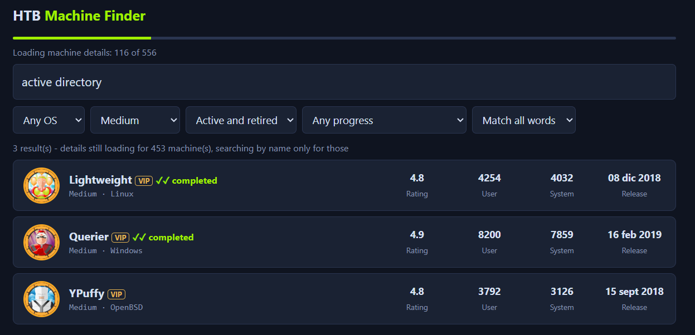

# HTB Machine Finder

A self-hosted search tool for Hack The Box machines. Search machine descriptions by topic, filter by operating system, difficulty and your own progress, and always see an up-to-date view of what you have already solved.



*Screenshot taken with sample data.*

## Contents

- [Why](#why)
- [Features](#features)
- [Installation](#installation)
- [Using the finder](#using-the-finder)
- [Everyday commands](#everyday-commands)
- [Configuration](#configuration)
- [How syncing works](#how-syncing-works)
- [Data and persistence](#data-and-persistence)
- [Security](#security)
- [Troubleshooting](#troubleshooting)
- [Limitations](#limitations)
- [Disclaimer](#disclaimer)
- [Contributing](#contributing)
- [License](#license)

## Why

The Hack The Box machine list can be filtered by difficulty and OS, but it cannot answer questions like "which Windows machines involve Kerberos that I have not finished yet?". HTB Machine Finder downloads the catalogue once, stores it on your computer, and lets you search the full description of every machine together with your own user and root flags.

## Features

- **Full-text search** over machine names and descriptions, with "match all words" and "match any word" modes.
- **Paginated results.** Matches are shown 15 per page with page navigation, so the full catalogue is always reachable.
- **Filters** for operating system, difficulty, active or retired, and personal progress: not started, user only, or completed (user and root).
- **Complete, verified sync.** A sync is only reported as finished once every machine in the catalogue has its details stored. Rate limits and transient errors are retried automatically until nothing is missing.
- **Always current progress.** Your progress is refreshed when the server starts, every time you open the page, when you return to the tab after a while, and on a schedule. A machine you finished on Hack The Box shows up as completed the next time you open the finder.
- **Token stays on the server.** The token is read from an environment variable and is never sent to the browser.
- **Persistent local cache.** Machine details are downloaded once and stored in a Docker volume, so restarts are instant and only new machines are fetched afterwards.
- **Nothing to install besides Docker.** The application runs inside one container.

## Installation

Requirements: **Git** and **Docker with Compose**. Docker Desktop (Windows and macOS) includes Compose; on Linux, install Docker Engine together with the Compose plugin.

The commands below work in a terminal on Linux and macOS, and in PowerShell or Command Prompt on Windows.

### Step 1. Install and start Docker

- **Windows and macOS:** install [Docker Desktop](https://docs.docker.com/desktop/) and open it. Wait until it reports that Docker is running.
- **Linux:** install [Docker Engine](https://docs.docker.com/engine/install/) and the [Compose plugin](https://docs.docker.com/compose/install/linux/), and make sure the service is running.

Check that both work:

```sh
docker --version
docker compose version
docker info
```

All three commands must succeed. If `docker info` reports that it cannot connect to the Docker daemon, Docker is not running yet. See [Troubleshooting](#troubleshooting).

### Step 2. Create a Hack The Box App Token

1. Sign in to Hack The Box and open your account settings: <https://app.hackthebox.com/account-settings>.
2. Click **Create App Token** and create the token.
3. Copy the token and keep it somewhere safe. Treat it like a password.

The finder only uses the token to read machine data and your own progress.

### Step 3. Get the project

```sh
git clone https://github.com/136avm/HTB-Finder.git
cd HTB-Finder
```

### Step 4. Add your token

Copy the example configuration file:

```sh
# Linux and macOS
cp .env.example .env

# Windows (PowerShell or Command Prompt)
copy .env.example .env
```

Open `.env` in any text editor and paste your token after `HTB_TOKEN=`, with no spaces or quotes:

```
HTB_TOKEN=your_token_here
```

Save the file. The `.env` file is ignored by Git, so your token is never committed.

### Step 5. Start the finder

```sh
docker compose up -d
```

The first time, Docker builds the image, which takes about a minute. When it finishes, open <http://localhost:8787> in your browser.

The status line at the top tells you what is happening:

1. `Syncing machine list and your progress...` The list of machines and your user and root flags are being downloaded. This takes a few seconds, after which you can already search by name and filter by progress.
2. `Loading machine details: 120 of 556` The description of each machine is being downloaded. The first time, this takes a few minutes because Hack The Box limits how fast its API can be used. You can keep using the page while it runs: searching by description works for the machines already loaded and covers the rest as they arrive.
3. `All 556 machines loaded.` Everything is stored. The next time you open the page this is immediate, and only your progress and any new machines are refreshed.

If the status line shows `retrying`, some machines could not be downloaded in the last attempt, usually because of rate limiting. The finder tries again on its own until every machine is loaded. You do not need to do anything.

## Using the finder

**Search.** Type in the large box. The search covers the machine name and its full description, so topics, techniques and technologies all work. Examples:

- `kerberos`
- `active directory`
- `sql injection`
- `docker`

By default a machine must contain every word you type. Switch to **Match any word** to see machines that contain at least one of them.

**Filters.** The drop-down menus combine with the search:

| Filter | Options |
| --- | --- |
| Operating system | Any, Linux, Windows, Other |
| Difficulty | Any, Easy, Medium, Hard, Insane |
| State | Active and retired, active only, retired only |
| Progress | Any, not started (no user, no root), user only, completed (user and root) |

For example, to find your next Windows machine about Active Directory that you have not finished, type `active directory`, choose **Windows** as the operating system, and choose **User only** or **Not started** as the progress.

**Pagination.** Results are shown 15 per page. Use the page buttons below the list to move through them. Changing the search or any filter returns you to the first page.

**Progress markers.** Each result shows how far you got: `user`, `root`, or `completed` for both flags. Machines you have not touched have no marker. A `VIP` tag means the machine requires a VIP subscription.

**Data section.** At the bottom of the page, **Data** lets you run **Sync now** to refresh immediately, or **Rebuild cache** to discard every stored description and download them again. You normally never need either.

## Everyday commands

Run these from the `HTB-Finder` folder.

| Task | Command |
| --- | --- |
| See whether it is running | `docker compose ps` |
| View the logs | `docker compose logs -f` |
| Stop it | `docker compose stop` |
| Start it again | `docker compose start` |

The container restarts automatically after a reboot unless you stop it with `docker compose stop` or `docker compose down`.

### Update to a new version

Your downloaded data is kept in a Docker volume, so updating does not trigger a new full download.

```sh
git pull
docker compose up -d --build
```

### Change the token or other settings

Edit `.env`, then apply the change:

```sh
docker compose up -d
```

### Uninstall completely

```sh
docker compose down -v --rmi all
```

This removes the container, the image and the stored data. Use `docker compose down` without `-v` to remove the container but keep the data.

## Configuration

All settings are environment variables. Put them in the `.env` file, one per line as `NAME=value`, and run `docker compose up -d` to apply them. `.env.example` lists the common ones.

| Variable | Default | Description |
| --- | --- | --- |
| `HTB_TOKEN` | none | Hack The Box App Token. Required for syncing. Without it the app serves cached data only. |
| `HTB_TOKEN_FILE` | none | Path to a file inside the container that contains the token. Use this with Docker secrets instead of `HTB_TOKEN`, if you adapt the Compose file. |
| `SYNC_INTERVAL_MINUTES` | `60` | Background refresh interval. `0` disables the schedule; syncs still run on start and when the page is opened. |
| `MIN_SYNC_GAP_SECONDS` | `10` | Minimum time between syncs triggered by opening the page. |
| `CONCURRENCY` | `4` | Parallel requests while downloading machine details. Lower it if retries are frequent. |
| `DATA_DIR` | `/data` in Docker | Directory where `machines.json` is stored. |
| `PORT` | `8787` | The port on your computer where the page is published. When running `node server.js` directly, the port the server listens on. |

## How syncing works

1. The server downloads the active and retired machine lists. Pagination is followed to the end and the result is compared with the total reported by the API. This list includes your user and root ownership flags, so progress is refreshed first and is visible right away.
2. It compares the list with the details already stored and downloads whatever is missing, a few requests at a time.
3. When the API answers with HTTP 429 or a server error, every worker pauses and the request is retried with exponential backoff, honouring `Retry-After` when present. Empty or malformed responses are treated as failures, not as data.
4. After each pass the server recomputes what is still missing and starts another pass. The sync only finishes when every listed machine has valid details. If passes stop making progress, the sync waits and tries again on its own.
5. If the token is rejected (HTTP 401) the sync stops and the page says so, instead of retrying forever. Data already stored keeps being served.

Progress is written to disk as it goes, so an interrupted first sync resumes where it stopped.

## Data and persistence

Everything is stored in a single file, `machines.json`, inside the `htb-data` Docker volume. It contains the machine list, your ownership flags and the downloaded machine details. It does not contain your token.

To start over without deleting the container, use **Rebuild cache** in the page. To delete the data entirely, see [Uninstall completely](#uninstall-completely).

## Security

- The token is held by the server and never reaches the browser, the page source or the stored data file.
- The server exposes no general-purpose proxy. It only contacts the Hack The Box machine endpoints it needs, and the browser cannot choose the URLs.
- State-changing endpoints require a custom request header, which prevents other websites from triggering them through your browser.
- The Compose file publishes the port on `127.0.0.1` only, so the finder is reachable from your own computer and not from your network. The application has no login screen: anyone who can reach it can read your machine progress and trigger syncs that use your token. If you expose it beyond your own machine, put it behind a reverse proxy with authentication.
- The token is stored in plain text in your `.env` file and is visible to anyone who can run `docker inspect` on your machine. Do not share the file, and do not run the finder on a shared system without restricting access to it.
- The container runs as a non-root user.

## Troubleshooting

**`docker: command not found` or `git: command not found`.** The tool is not installed, or the terminal was opened before installing it. Install it (step 1 for Docker) and open a new terminal.

**`docker: 'compose' is not a docker command`.** The Compose plugin is missing. It is included in Docker Desktop. On Linux, install the [Compose plugin](https://docs.docker.com/compose/install/linux/).

**`Cannot connect to the Docker daemon` or `error during connect`.** Docker is installed but not running. On Windows and macOS, open Docker Desktop and wait until it says it is running. On Linux, start the service, for example `sudo systemctl start docker`.

**`permission denied` on Linux.** Your user is not allowed to use Docker. Prefix the commands with `sudo`, or follow the [post-installation steps](https://docs.docker.com/engine/install/linux-postinstall/).

**`required variable HTB_TOKEN is missing a value`.** The `.env` file does not exist or the token line is empty. Check that the file is named exactly `.env`, sits in the project folder next to `docker-compose.yml`, and contains `HTB_TOKEN=` followed by your token. On Windows, make sure the editor did not save it as `.env.txt`.

**`port is already allocated` or `address already in use`.** Something else uses port 8787. Add `PORT=9090` to `.env`, run `docker compose up -d` again, and open <http://localhost:9090>.

**The page says `HTB_TOKEN is not configured`.** The container started without a token. Fix `.env` and run `docker compose up -d` again.

**The page says `Hack The Box rejected the token`.** The token is invalid, expired or revoked. Create a new App Token, update `.env` and run `docker compose up -d`.

**The first sync is slow.** Expected. Hack The Box limits API usage and the server backs off when it is told to. The status line shows live progress. Lowering `CONCURRENCY` in `.env` can help if retries are frequent.

**Progress looks outdated.** Open **Data** at the bottom of the page and press **Sync now**. Syncs triggered by opening the page are skipped if one finished in the last `MIN_SYNC_GAP_SECONDS` seconds.

**Still stuck.** Run `docker compose logs` and include the output when you open an issue.

## Limitations

- The tool relies on the same API endpoints the Hack The Box website uses. They are not a documented public API and may change without notice.
- It is designed for a single user and a single token per instance.

## Disclaimer

HTB Machine Finder is an independent project. It is not affiliated with, endorsed by or sponsored by Hack The Box. "Hack The Box" and "HTB" are trademarks of their respective owners. Use it in accordance with the Hack The Box terms of service and keep your token private.

## Contributing

Issues and pull requests are welcome. The whole application is `server.js` and `public/index.html`; there is no build step. Run `node --check server.js` before submitting changes.

## License

Released under the [MIT License](LICENSE).